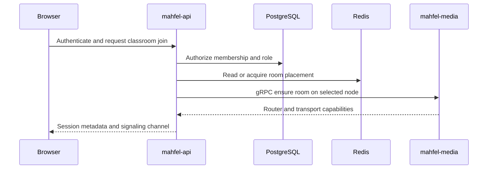
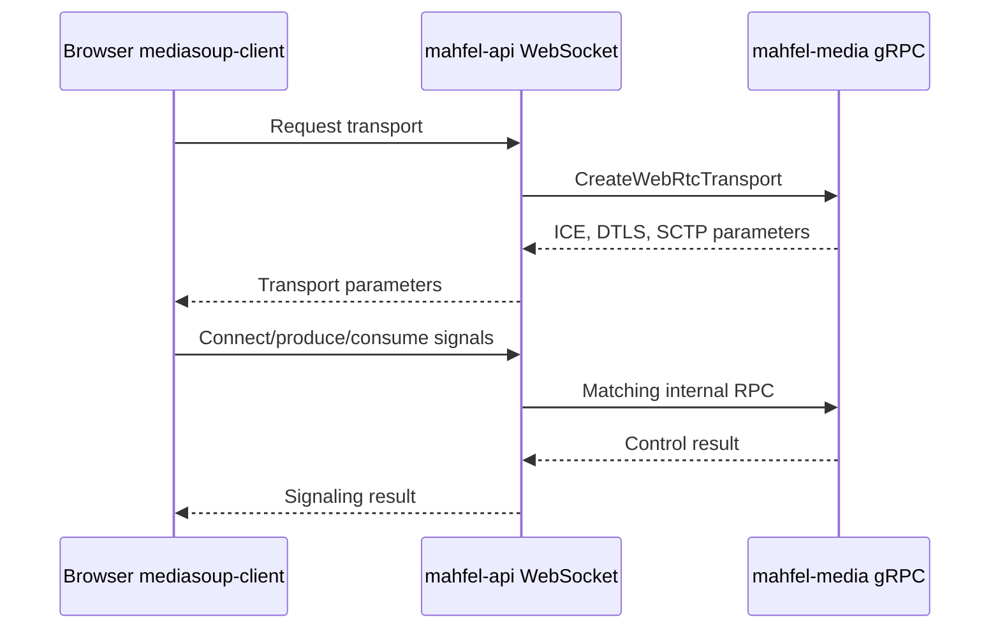
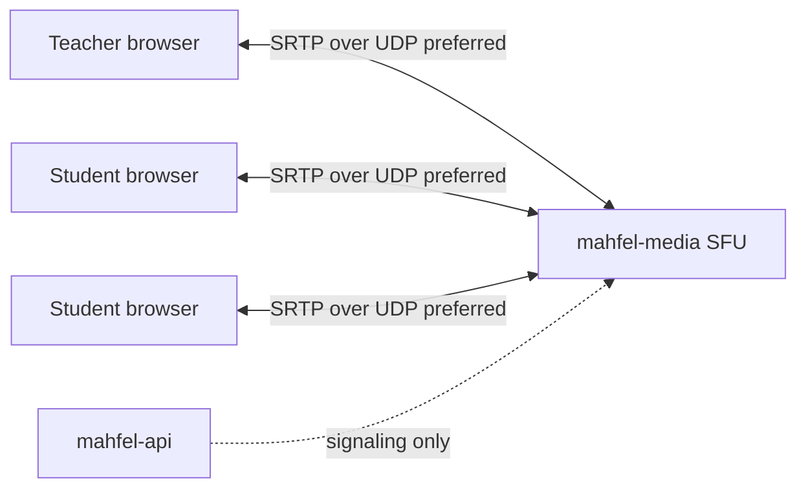
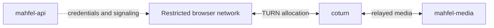
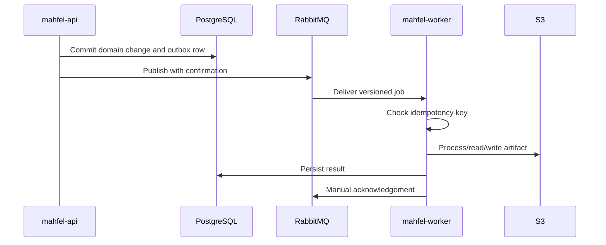

# Runtime data flows

## Classroom join

## WebRTC signaling

## Direct media path

## TURN fallback

## Background job processing

Transient failures are retried; poison jobs are routed to a dead-letter queue (DLQ).

## File transfer

The browser asks `mahfel-api` to authorize an operation and issue a short-lived presigned URL. The
browser transfers bytes directly to S3. The API persists metadata and permissions in PostgreSQL;
large file bodies are not proxied through API or Next.js under the normal path.
