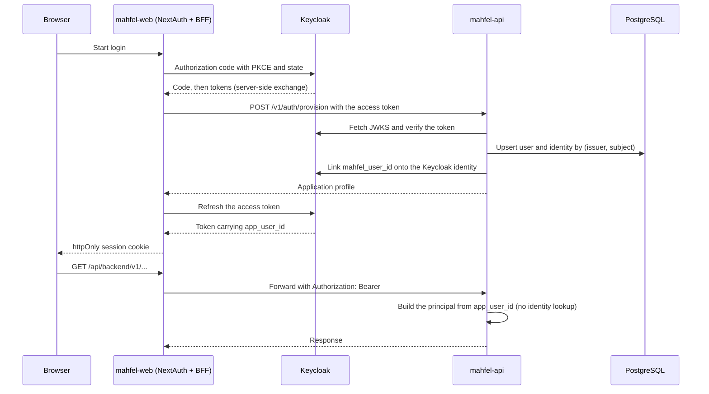
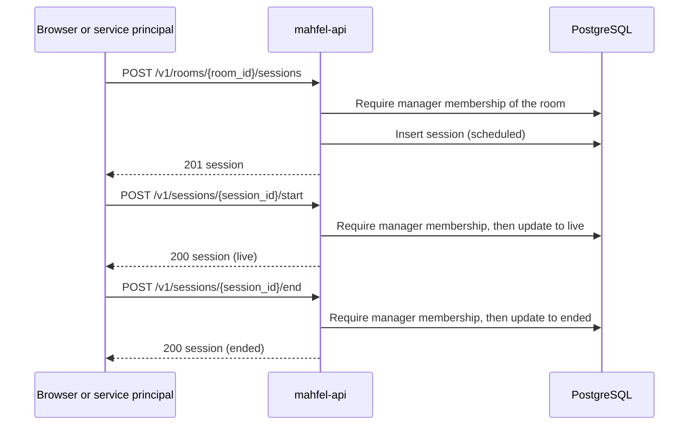
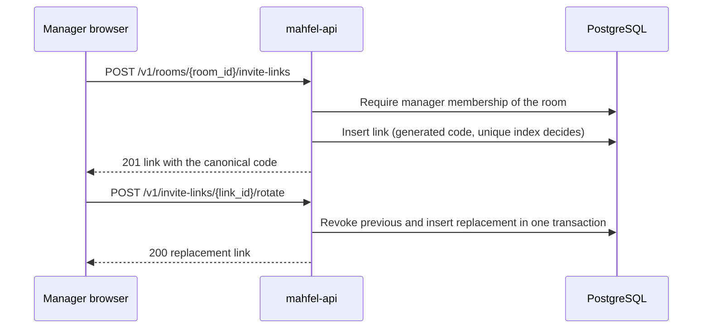
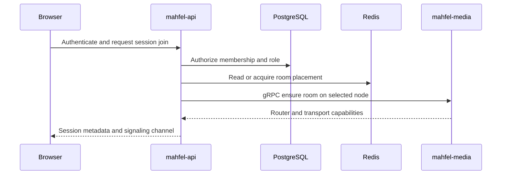
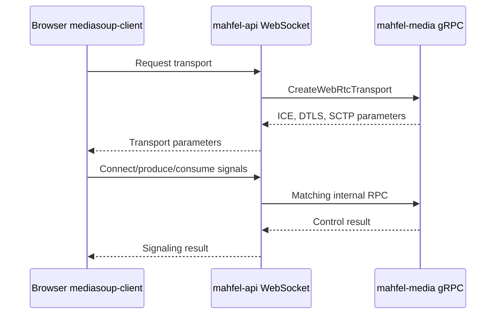
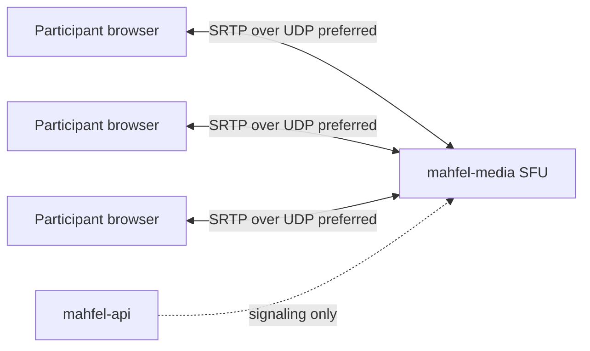
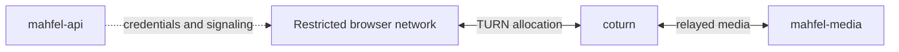
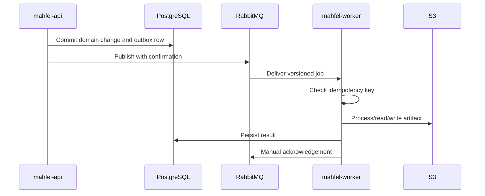

# Runtime data flows

## Authentication and session

## Session lifecycle

A session moves `scheduled` to `live` to `ended`, or `scheduled` to `cancelled`; any other
transition is rejected with `409` and leaves the row unchanged. At most one session per room may be
`live`; a partial unique index makes a concurrent second start fail with `409` instead of creating a
second live session. Every accepted action writes a structured `audit` log line. Sessions are
scheduled and controlled by room managers only. Member-facing join lives in the session-join flow
below, and connected time is recorded durably in `mahfel.participation_intervals` (M4-03): a join
opens an interval, a leave or any transport disconnect closes it, and ending a session sweeps any
interval still open so none outlives its session.

## Invite links

Management is capability-gated for the target and audited. A code is a bearer capability, so its
expiry and revocation are enforced on redemption rather than stored as a derived flag, and the code
never appears in logs or metric labels (ADR 0021). Redemption and the confirmation flow that follows
it belong to M4-14 (TASK-130).

## Session join

## WebRTC signaling

## Direct media path

## TURN fallback

## Background job processing

Transient failures are retried; poison jobs are routed to a dead-letter queue (DLQ).

## File transfer

The browser asks `mahfel-api` to authorize an operation and issue a short-lived presigned URL. The
browser transfers bytes directly to S3. The API persists metadata and permissions in PostgreSQL;
large file bodies are not proxied through API or Next.js under the normal path.
