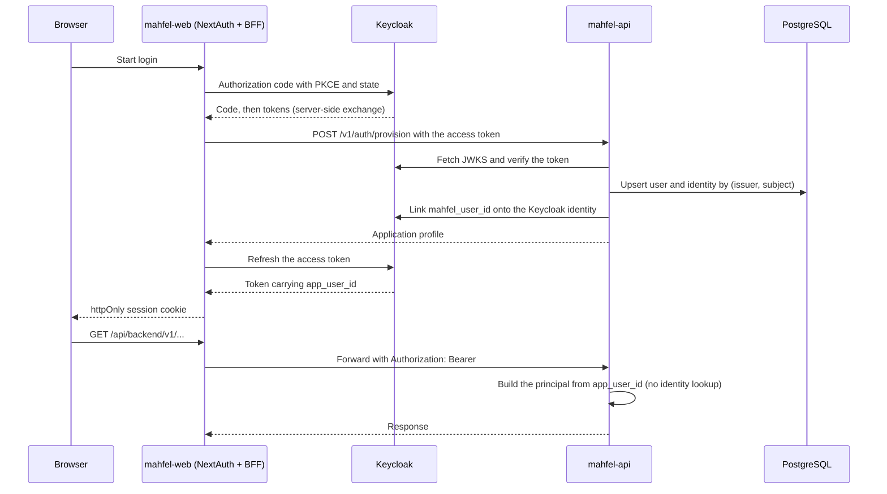
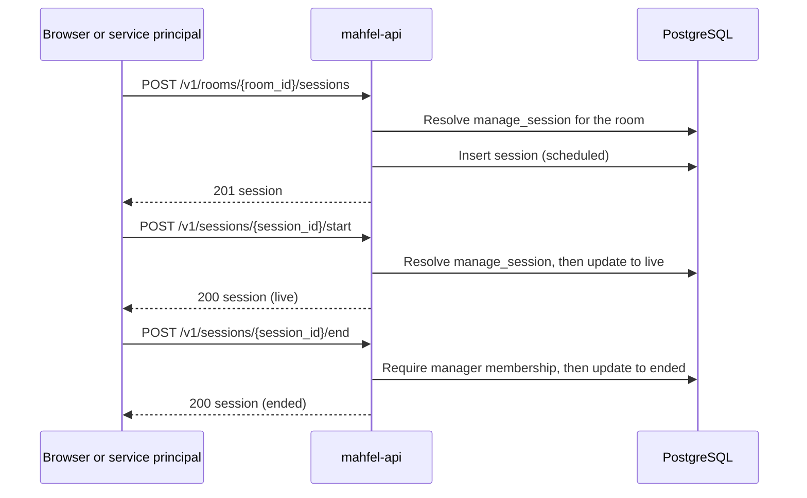
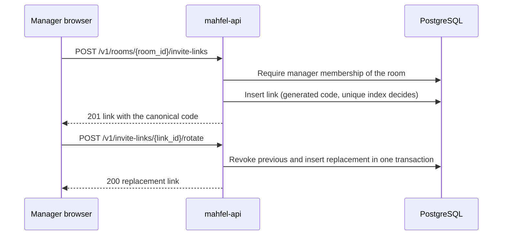
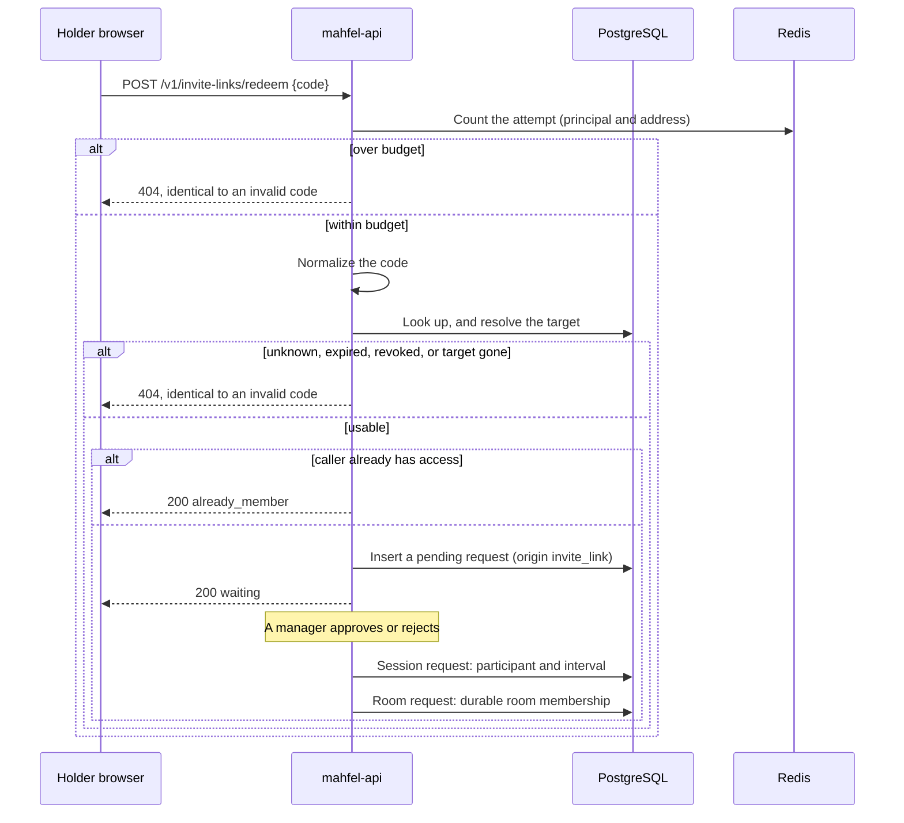
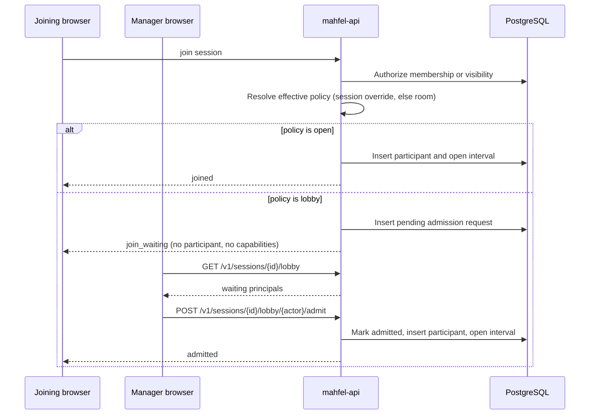
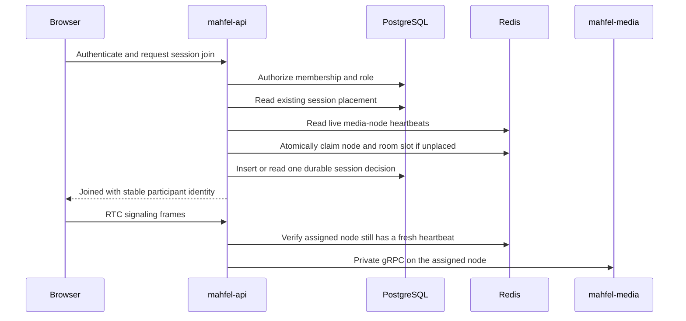
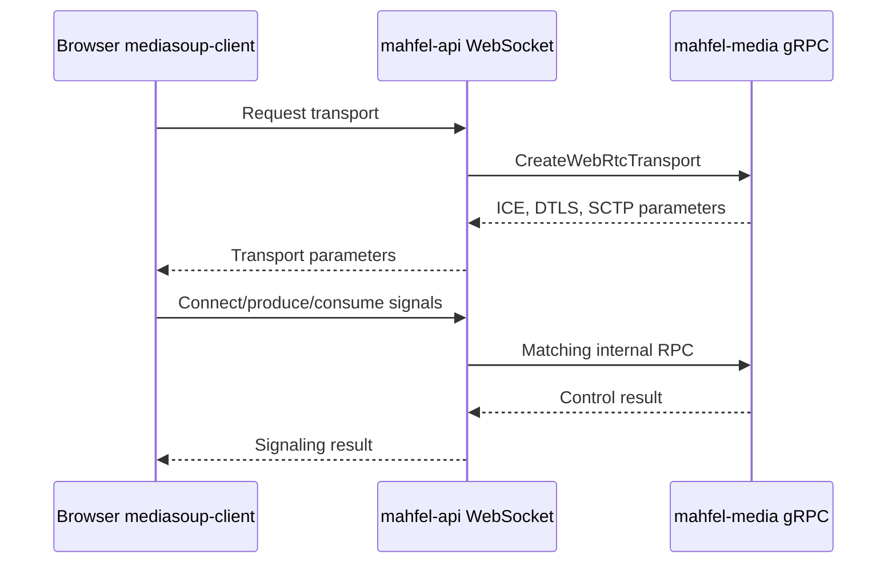
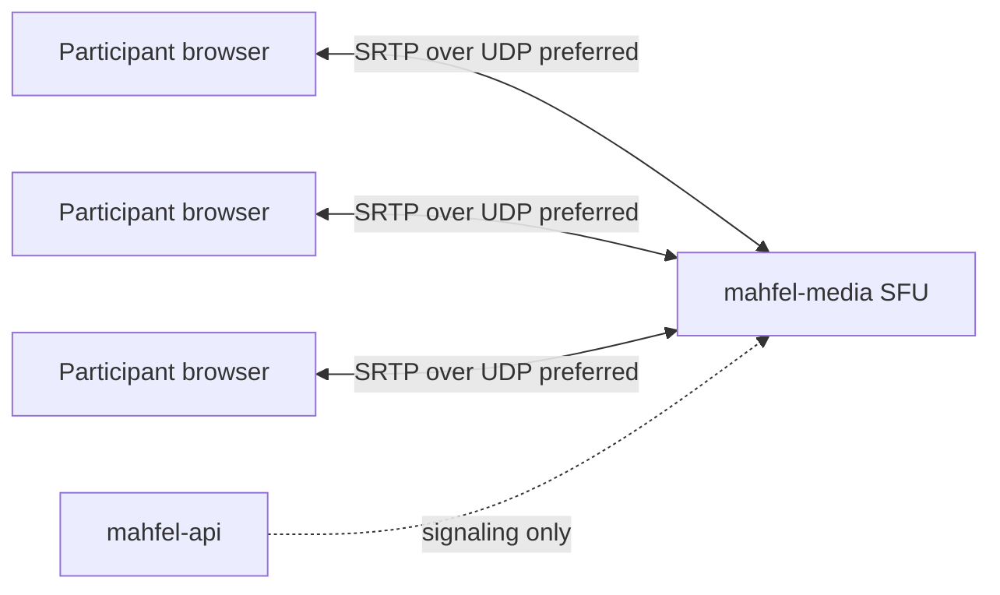
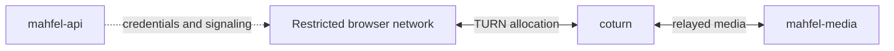
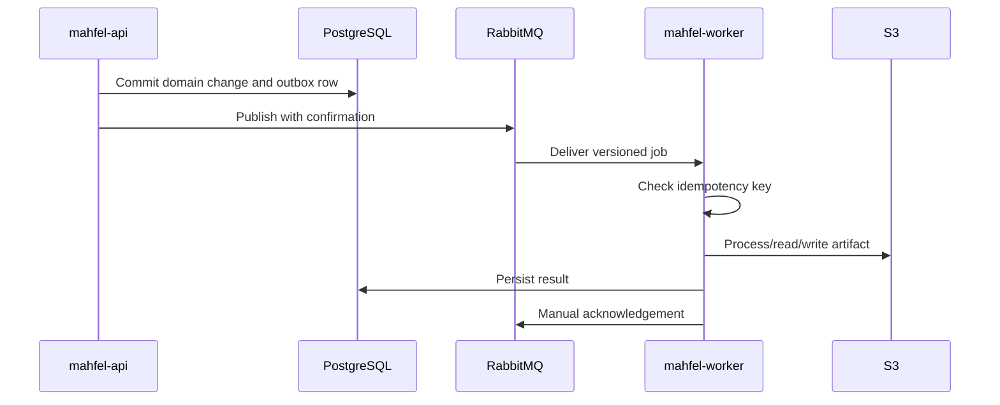

# Runtime data flows

## Authentication and session



## Session lifecycle



A session moves `scheduled` to `live` to `ended`, or `scheduled` to `cancelled`; any other
transition is rejected with `409` and leaves the row unchanged. At most one session per room may be
`live`; a partial unique index makes a concurrent second start fail with `409` instead of creating a
second live session. The optional planned start never gates an explicit start, and the optional
1–10080 minute duration never triggers an automatic end. A session may have a custom title; absent
one, reads display the room's current title. `PATCH /v1/sessions/{session_id}` may change or clear
title and advisory schedule fields in any state, including ended/cancelled, with the
`manage_session` capability. Every accepted action writes a structured `audit` log line. Scheduling
and starting require `manage_session`; end and cancel remain manager-scoped. Member-facing join lives in the session-join flow
below, and connected time is recorded durably in `mahfel.participation_intervals` (M4-03): a join
opens an interval, a leave or any transport disconnect closes it, and ending a session sweeps any
interval still open so none outlives its session.

## Invite links



Management is capability-gated for the target and audited. A code is a bearer capability, so its
expiry and revocation are enforced on redemption rather than stored as a derived flag, and the code
never appears in logs or metric labels (ADR 0021).

## Invite redemption



Redemption resolves and queues; it never joins. Session-link approval grants attendance in that
session only and no membership, so the holder may be asked again later. Room-link approval grants
durable membership and needs no live session, because the room outlives any one session. Every
unusable code returns one identical error and attempts are rate-limited first, so the endpoint cannot
be used to enumerate valid codes.

## Admission



Authorization runs first and is unchanged; admission decides only whether an already-authorized
caller enters now or waits. A session's access settings inherit from its room and may only tighten,
so a session cannot expose a room the room itself protects. Ending a session retires any pending
requests, so no one is left waiting on a session that no longer exists.

## Session join



## Moderation

```mermaid
sequenceDiagram
  participant B as Manager browser
  participant A as mahfel-api
  participant P as PostgreSQL
  participant M as mahfel-media
  B->>A: mute_participant {actor_id, kind, source}
  A->>P: Resolve membership and capability
  alt no mute_others
    A-->>B: forbidden
  else
    A->>P: Load the active participant
    alt no active participant
      A-->>B: not_found, before any media call
    else
      A->>P: Record muted_at, mute_kind, muted_by
      A->>M: gRPC PauseParticipantSource {room, actor, source}
      alt media plane unreachable
        Note over A: Audited as degraded; the durable mute stands
      end
      A-->>B: participant_muted
      Note over A: Fanned out to every connection of the participant
    end
  end
```

The order is the property that matters, and it is the same for every moderation action: resolve the
capability, resolve the target against the authoritative store, change durable state, reach the media
plane, then audit and propagate. Capability first so an unauthorized caller cannot probe for who
exists, and the state change before enforcement so a media outage degrades rather than misreports.

A capability withdrawal reconciles rather than sweeping: removing a membership or blocking closes
the producers whose source the principal may no longer publish, while a demotion closes nothing
because a member keeps `publish_media` and `share_screen`. Removing a membership while a principal is
publishing closes their producers for the same reason a block does: the grant they were publishing
under is gone.

Presence is derived from the connection registry rather than from a single connection, so a
participant on two devices stays present when one closes and `participant_left` is emitted only at
the last one.

## WebRTC signaling



## Direct media path



## TURN fallback



## Background job processing



Transient failures are retried; poison jobs are routed to a dead-letter queue (DLQ).

## File transfer

The browser asks `mahfel-api` to authorize an operation and issue a short-lived presigned URL. The
browser transfers bytes directly to S3. The API persists metadata and permissions in PostgreSQL;
large file bodies are not proxied through API or Next.js under the normal path.
