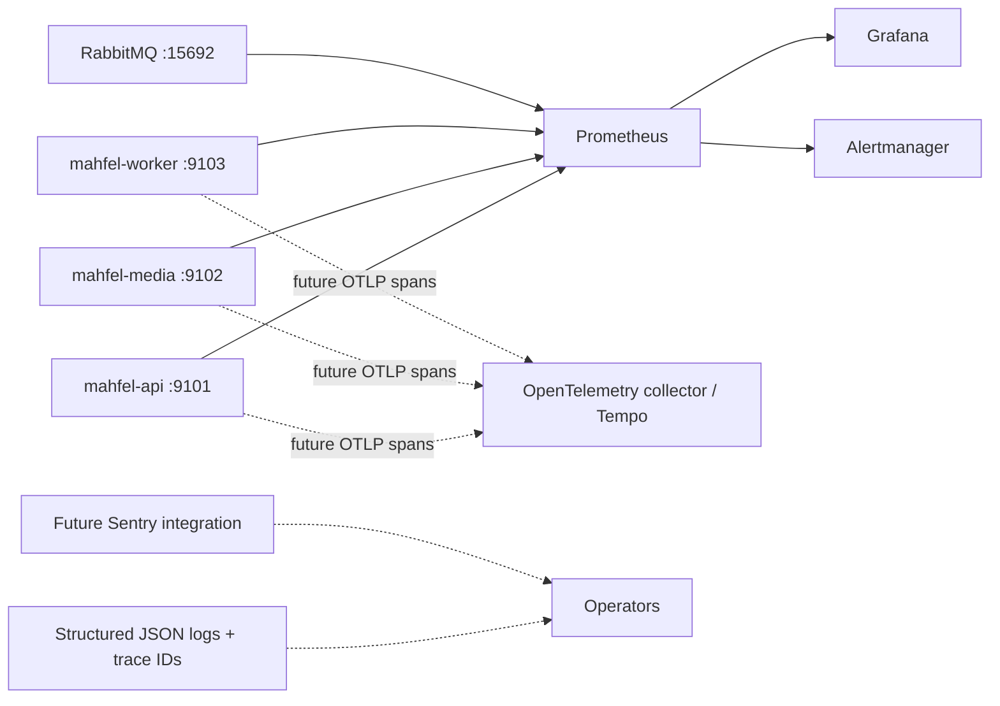

# Observability

Each Rust service has a dedicated private operations listener:

- `/metrics` is Prometheus text exposition.
- `/health/live` proves the process and event loop can respond. It does not depend on every remote
  system and should not create restart storms.
- `/health/ready` proves the service can accept useful work and returns 503 otherwise.

API readiness currently requires completed initialization and PostgreSQL. Redis and RabbitMQ are
secondary API dependencies and should later degrade individual capabilities rather than force API
restart loops. Media readiness requires initialized mediasoup workers and a bound control server.
Worker readiness requires RabbitMQ connectivity. Readiness failure removes traffic/work; liveness
failure is the only routine reason for an orchestrator restart.

Bootstrap exports process metrics and `mahfel_service_ready`, with constant `service` and `version`
labels. The API additionally exports `mahfel_websocket_*` gauges and counters for active and
accepted connections, cap rejections, disconnects by reason, messages, and send drops. Future media metrics cover active rooms, participants, workers, routers, transports,
producers, consumers, ingress/egress bytes and bitrate, packet loss, retransmissions, RTT, and
available outgoing bitrate.

Prometheus labels must stay bounded. Never label metrics with `user_id`, `room_id`, `producer_id`,
email address, or other per-entity identifiers. Put those identifiers in structured logs and traces,
subject to privacy policy, and correlate with trace/request IDs.
