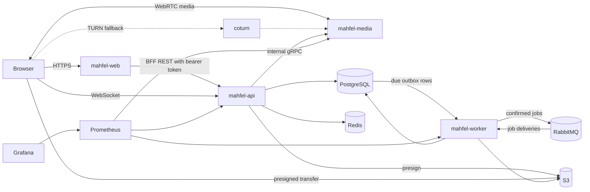

# Architecture overview

Mahfel separates browser delivery, authoritative control-plane work, realtime media, and durable
background work. PostgreSQL is the durable source of truth. Redis holds replaceable distributed
coordination state. RabbitMQ transports durable jobs. S3 stores file and media artifacts.

Authenticated REST calls go from the browser to `mahfel-web`, whose narrow BFF forwards allowlisted
`/v1` paths to `mahfel-api` with the Keycloak access token (ADR 0019). WebSocket signaling connects
to the API directly. Next.js is not a general proxy: WebSocket, media, and presigned S3 traffic
never pass through it. Signaling passes through the API, but negotiated media never does: direct
WebRTC flows between browser and media node, falling back through coturn only when network traversal
requires it.

Keycloak is the single OIDC provider: local development and integration tests run it behind the
local Caddy route, and production configuration points the same standards-based OIDC client at the
deployment Keycloak. There is no separate local-only provider.

## Data ownership

| System | Role | Authoritative? |
|---|---|---|
| PostgreSQL | Users, rooms, sessions, permissions, chat, file metadata, job outbox | Yes |
| Redis | Presence, leases, node registry, room placement cache, coordination | No |
| RabbitMQ | Durable delivery of commands and jobs | Delivery state only |
| S3 | Files, recordings, thumbnails, exports | Artifact bytes |
| mediasoup nodes | Live media objects and statistics | Only for the active session |

The runtime architecture is modular without becoming a microservice exercise. Domain capabilities
such as auth, chat, files, collaboration, and AI are library/module boundaries inside the three Rust
runtime services, not separately deployed services.
