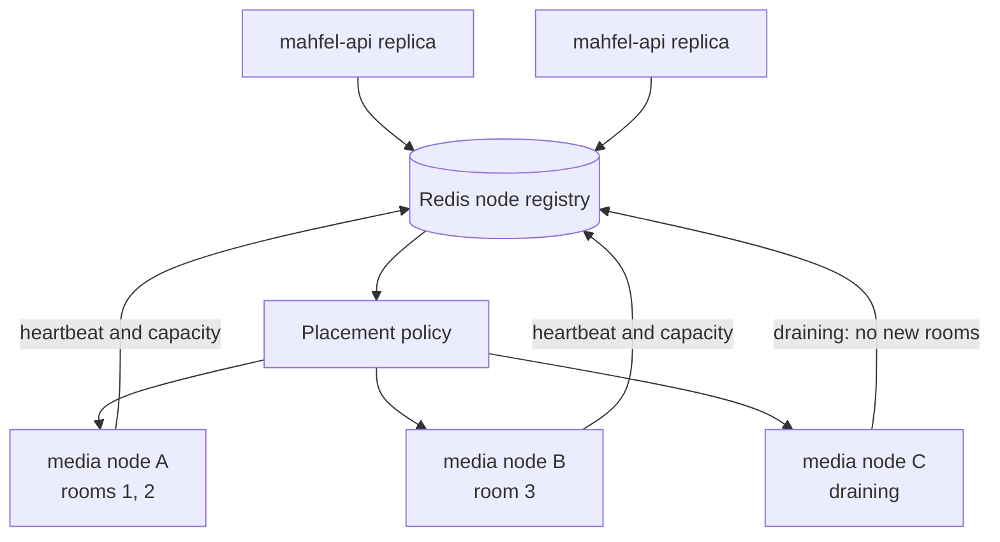

# Scaling and resilience

API and worker containers are stateless and scale horizontally. PostgreSQL connection budgets,
Redis coordination behavior, and RabbitMQ consumer concurrency constrain replica counts. Workers
compete through acknowledgements and must make every job idempotent.

Media replicas are stateful only for the duration of live rooms. Media processes now publish
short-lived node capacity and draining state to the API's Redis registry. The placement scheduler
and sticky session lease are M4-09; the current RTC path still uses one configured media URL.
PostgreSQL retains durable session metadata. Redis loss makes registry reads unavailable and later
placement must reconstruct its ephemeral state rather than lose business truth.

The intended routing path after M4-09 is:

The initial sizing hypothesis—300–400 mostly-listener participants on a 4-vCPU/8-GB media replica—is a
load-test starting point, not a capacity promise. CPU, memory, egress, packets per second, consumers,
loss, RTT, and retransmissions must determine measured admission limits.

The registry holds draining until the final heartbeat expires. Excluding draining nodes from new
placement and allowing existing rooms to finish is part of M4-09 and deployment drain behavior.
Unexpected node loss initially disconnects its rooms; reconnect/recovery guarantees must be made
explicit through resilience testing. coturn needs its own capacity, stable public address, relay
port range, and bandwidth planning.
