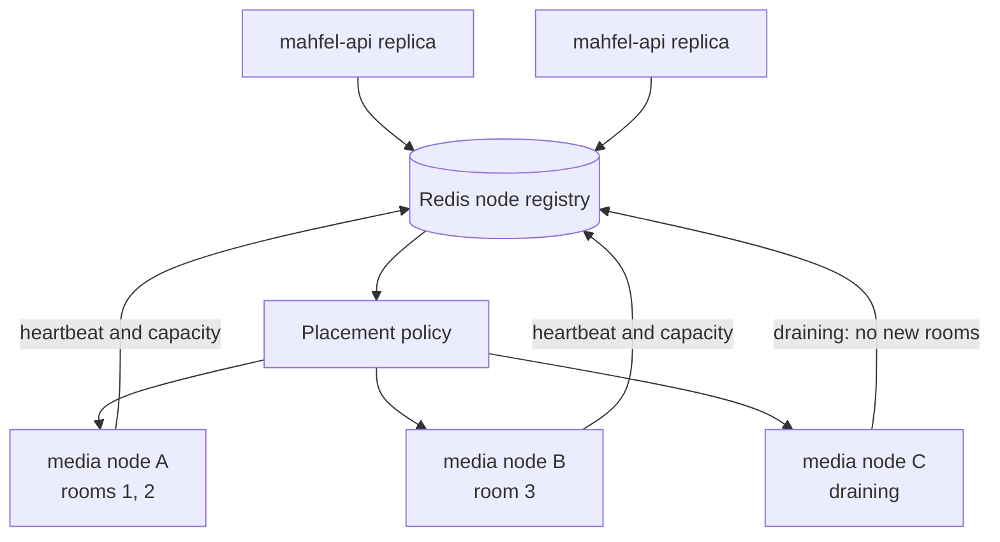

# Scaling and resilience

API and worker containers are stateless and scale horizontally. PostgreSQL connection budgets,
Redis coordination behavior, and RabbitMQ consumer concurrency constrain replica counts. Workers
compete through acknowledgements and must make every job idempotent.

Media replicas are stateful only for the duration of live rooms. Media processes publish
short-lived node capacity and draining state to the API's Redis registry. Before an admitted join
writes a participant, the API places its session on one live node. Draining, full, and workerless
nodes cannot receive new sessions. Weighted rendezvous ordering favors available room slots; a
Redis script rechecks each candidate's current heartbeat, drain flag, and room count while it
atomically reserves one slot. The API creates the room on the assigned SFU before admitting a
participant, so the next heartbeat counts it even when a client delays its first transport. The
namespaced `media_placement:<session-id>` key and `media_reservations:node:<node-id>` sorted set
expire after twenty seconds, matching the heartbeat lifetime, so an abandoned claim cannot occupy
capacity indefinitely. While a new room's heartbeat has not arrived, both its reservation and
room count may be counted; this can briefly reduce placement capacity. The room
limit remains an admission signal based on heartbeats and reservations; the SFU does not enforce
a separate hard room cap.

Ending a session deletes its SFU room to free the capacity reported by heartbeats; if deletion
fails, the API attempts to clear its media and records the degraded cleanup in logs.

The first decision is written to `mahfel.media_placements` with one row per session, including
node ID, room ID, observed capacity and room count, reason, and decision time. PostgreSQL's unique
session key resolves a race even if a Redis lease disappears during the write. Every later RTC,
moderation, transport-cleanup, session-end, and speaker request resolves the same session's node.
Within that node, the SFU uses a session-derived internal room ID. The browser continues to use
the durable business room ID. This keeps a later session in the same business room from inheriting
the previous session's router or losing its media to delayed cleanup.
The Redis lease is coordination; the PostgreSQL row remains the durable assignment. A registry
outage rejects new routing and placement as unavailable. When Redis recovers, a durable decision
can be used again only if that exact node has a fresh heartbeat.

The routing path is:



The initial sizing hypothesis—300–400 mostly-listener participants on a 4-vCPU/8-GB media replica—is a
load-test starting point, not a capacity promise. CPU, memory, egress, packets per second, consumers,
loss, RTT, and retransmissions must determine measured admission limits.

The registry holds draining until the final heartbeat expires. Existing sessions keep their
assigned draining node. If that node dies, joins and signaling for the session return unavailable;
the scheduler does not silently move volatile SFU resources to another node. Recovery and
renegotiation after unexpected node death belong to M13-06. Operators can inspect decisions with:

```sql
SELECT session_id, room_id, node_id, max_rooms, active_rooms, reason, decided_at
FROM mahfel.media_placements
WHERE session_id = $1;
```

coturn needs its own capacity, stable public address, relay port range, and bandwidth planning.
