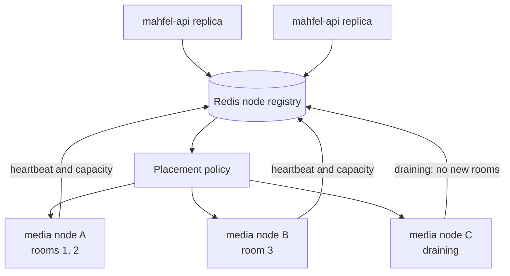

# Scaling and resilience

API and worker containers are stateless and scale horizontally. PostgreSQL connection budgets,
Redis coordination behavior, and RabbitMQ consumer concurrency constrain replica counts. Workers
compete through acknowledgements and must make every job idempotent.

Media replicas are stateful only for the duration of live rooms. A scheduler records node
heartbeats/capacity in Redis and places a room on one node; participants in that room return to the
same node. PostgreSQL retains durable session metadata, but Redis loss requires reconstruction of
placement rather than loss of business truth.

The initial sizing hypothesis—300–400 mostly-listener students on a 4-vCPU/8-GB media replica—is a
load-test starting point, not a capacity promise. CPU, memory, egress, packets per second, consumers,
loss, RTT, and retransmissions must determine measured admission limits.

Graceful media draining prevents new room placement and lets existing rooms finish. Unexpected node
loss initially disconnects its rooms; reconnect/recovery guarantees must be made explicit after the
M3 proof of concept and resilience testing. coturn needs its own capacity, stable public address,
relay port range, and bandwidth planning.
